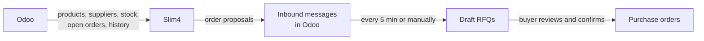
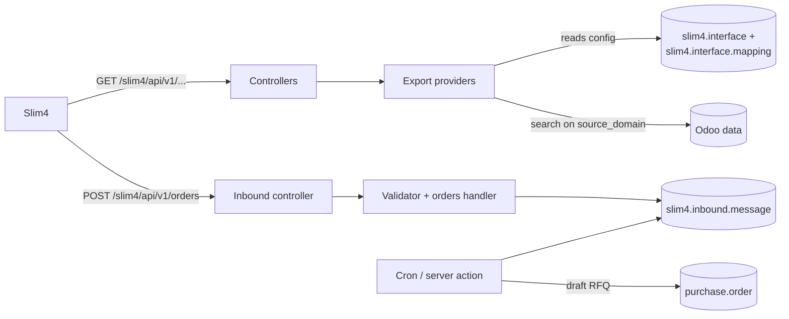

# Slim4 Connector

Full documentation of the Slim4 connector, covering the three modules `slim4_connector_base`, `slim4_connector_api` and
`slim4_connector_api_inbound`.

The SLIM4 connector lets Slimstock's Slim4 planning tool read Odoo's products, suppliers, stock, orders and history, and
turns Slim4's order proposals into draft purchase orders in Odoo. This guide explains how to use and configure it;
developer details are in the [Technical reference](#technical-reference) at the end.

## What the connector does

Slim4 is always the one that starts the exchange: it pulls data from Odoo on its own schedule and pushes order proposals
back. Nobody in Odoo has to export or import files.

### What Slim4 reads from Odoo

<!-- markdownlint-disable MD013 -->

| Data set | What Slim4 gets | Which Odoo records are included |
| --- | --- | --- |
| Article Filter | The list of articles to plan, per warehouse | Active products with an internal reference |
| Article Code Master | Article details: description, cost and sales price, weight, volume, unit, barcode | Same as Article Filter |
| Logistics | Per article: primary supplier, lead time, MOQ, IOQ, purchase price, supplier article code | Active products with an internal reference **and a primary supplier** |
| Suppliers | All supplier options per article, with the same logistics data | Every vendor pricelist line of an active, coded product |
| Purchase Order | Open incoming quantities: PO number, supplier, planned date, open quantity | Confirmed PO lines not fully received |
| Confirmed Demand | Open customer demand: SO number, customer, required date and quantity | Confirmed SO lines not fully delivered |
| Stock Details | Stock on hand per warehouse (and lot) | Stock in internal locations |
| Transactions | History of completed stock moves (mainly deliveries), used for forecasting | Done stock moves of coded products |

<!-- markdownlint-enable MD013 -->

### What Slim4 sends to Odoo

Order proposals: per line an article, a supplier, a quantity, an optional expected date and an optional warehouse. Odoo
stores them and turns them into **draft** requests for quotation. Nothing is confirmed or sent to a supplier
automatically.

## Key concepts

Slim4 and Odoo recognise records by a few shared keys. If these keys are missing or duplicated, data is left out or
orders cannot be matched.

<!-- markdownlint-disable MD013 -->

| Concept | In Odoo | Why it matters |
| --- | --- | --- |
| Article code | Product **Internal Reference** | The only key for an article. Must be unique; products without one are never sent to Slim4 |
| Supplier number | Contact **Reference** (Sales & Purchase tab) | Slim4 knows suppliers by this reference and uses it in order proposals. Must be unique |
| Warehouse code | Warehouse **Short Name** | Identifies the warehouse in every data set and in order proposals |
| Slim4 warehouses | Product › Inventory tab | Warehouses in which Slim4 should plan this product. Empty = all warehouses |
| Primary supplier | Product › Purchase tab › *Primary Supplier* | The vendor line Slim4 uses for lead time, MOQ, IOQ and price in Logistics |

<!-- markdownlint-enable MD013 -->

## Daily use: products and suppliers

Most of the connector runs by itself; the team's job is to keep master data complete. A product only reaches Slim4
correctly when the checklist below is met.

### New product

- [ ] Internal Reference filled in and unique (Module refuses duplicates).
- [ ] Product is active.
- [ ] At least one vendor line on the Purchase tab with price, minimum quantity and lead time.
- [ ] A **Primary Supplier** selected on the Purchase tab, otherwise the product is missing from Logistics.
- [ ] *Slim4 Warehouses* set on the Inventory tab if the product is not stocked in every warehouse.

### New supplier

- [ ] Reference filled in and unique. The module shows a *Potential duplicate* warning on the contact when another
      contact has the same reference.

### Good to know

- For variant products, only vendor lines valid for that variant (or for all variants) can be chosen.
- Purchase prices are sent in the supplier's purchase currency, or the company currency if none is set.
- Changes are picked up the next time Slim4 pulls data; there is nothing to trigger in Odoo.

## Configuring the connector

Everything is under the **Slim4** app › Configuration. The default setup works out of the box; change it only when a
client needs different data in Slim4. Configuration changes require Settings (administrator) rights.

### Settings

Three options, all on by default. Turn one off only if the client uses its own custom fields.

| Option | What it adds |
| --- | --- |
| Warehouse | *Slim4 Warehouses* field on products |
| Primary Supplier | *Primary Supplier* field on products |
| Incremental Order Quantity (IOQ) | *IOQ* column on vendor lines |

When an option is off, the fields that depend on it no longer work. **Validate Mapping** then reports an error until
another field is chosen, and Slim4 gets an error on that data set.

### Interfaces

One interface per data set (the eight listed above). Per interface you can:

- **Archive** it to stop Slim4 from reading that data set.
- Adjust **Source Domain**: the filter that decides which records are included (e.g. exclude a product category).
- Review the **field mapping**: which Odoo value goes into each Slim4 field.

### Field mapping

Each Slim4 field is one line with a status and a way to fill it.

| Status | Effect |
| --- | --- |
| Validated | Sent to Slim4 |
| To Validate | Not sent yet; waiting for a decision |
| Ignored | Not sent (optional Slim4 field the client does not use) |

<!-- markdownlint-disable MD013 -->

| Mapping type | Use it for | Example |
| --- | --- | --- |
| Odoo Field Path | Take a value from an Odoo field, also via related records | Supplier name → *Vendor › Name* |
| Constant Value | Always send the same value | Order type = `1` |
| Python Rule | Calculated values; a small code snippet (developer or experienced consultant) | Open quantity = ordered − received |

<!-- markdownlint-enable MD013 -->

Fields marked *Required* must have a value for every record; one empty value stops that whole data set for Slim4 (see
Points of attention).

Buttons on the interface:

- **Validate Mapping** — checks that every validated line is complete and points to an existing field.
- **Preview JSON** — shows the first 5 records exactly as Slim4 would receive them. Use it after every change.
- **Reset Mapping** — restores the standard configuration of that interface.

## Orders from Slim4

Slim4 order proposals land in **Slim4 › Inbound Messages** and become draft RFQs; a buyer always reviews and confirms
them in Purchase. One message is created per proposed order line.

### From proposal to RFQ

1. Slim4 sends a set of proposals (one *batch*). Odoo checks the whole set first; if one line is malformed (missing
   article, supplier or quantity, invalid date), the whole set is refused and Slim4 gets an error.
2. Every accepted line becomes a message. Odoo looks up the article (Internal Reference), the supplier (Reference) and
   the receipt type of the warehouse.
3. Lines that are found get status **Received**; lines with an unknown article or supplier get status **Error** with the
   reason.
4. Every 5 minutes (or on demand) Odoo turns *Received* messages into draft RFQs: **one RFQ per supplier and warehouse
   per batch**, with one line per article. Price, unit and taxes come from the supplier pricelist as usual; the planned
   date is the date Slim4 proposed.
5. Messages move to **Processed**. The buyer finds the new RFQs in Purchase and confirms them.

### Message statuses

<!-- markdownlint-disable MD013 -->

| Status | Meaning | What to do |
| --- | --- | --- |
| Received | Ready, waiting for processing | Nothing; or run *Process Received Orders* from the Action menu to process now |
| Processed | RFQ created | Review the RFQ in Purchase |
| Error | Article or supplier not found, or supplier reference used by several contacts | Fix the product or contact, then ask Slim4 to send the proposal again (an error message cannot be reprocessed) |

<!-- markdownlint-enable MD013 -->

Automatic processing runs through the scheduled action *Slim4: Process received orders*. It is **off after
installation** and must be switched on (Settings › Technical › Scheduled Actions). The list shows *Received* messages by
default; use the filters for errors or group by batch.

## Go-live checklist

Run through this list for each new client environment before Slimstock connects.

- [ ] Internal References are unique (installation is blocked otherwise) and filled on every product to plan.
- [ ] Supplier References are unique and agreed with Slimstock.
- [ ] Every warehouse has a short, stable code agreed with Slimstock.
- [ ] Primary suppliers are set on all products that Slim4 must plan (Logistics).
- [ ] Slim4 warehouses are set on products that are not stocked everywhere.
- [ ] Each interface reviewed with the client: statuses, source filter, **Validate Mapping** and **Preview JSON** OK.
- [ ] An integration user for Slimstock exists, with access to products, purchase, sales and inventory **and** the group
      *Slim4: Receive Inbound API Data*.
- [ ] An API key has been created for that user and handed to Slimstock together with the Odoo URL.
- [ ] Scheduled action *Slim4: Process received orders* is switched on.
- [ ] A test order from Slim4 has produced a correct draft RFQ.
- [ ] Changes to the standard mapping are written in the mapping line *Notes* (a module update can reset them).

## Troubleshooting

<!-- markdownlint-disable MD013 -->

| Symptom | Likely cause | What to do |
| --- | --- | --- |
| Product missing in Slim4 | No Internal Reference, product archived, or (Logistics) no primary supplier | Complete the product |
| Product planned in the wrong warehouses | *Slim4 Warehouses* empty, so all warehouses are sent | Set the warehouses on the product |
| Slim4 reports an error on a whole data set | A required field is empty on one record, or a mapping is invalid | Open the interface, run **Validate Mapping** and **Preview JSON**; the error names the record |
| Slim4 cannot connect at all | API key wrong, expired or revoked | Check the integration user's API keys; create a new one if needed |
| Slim4 order refused completely | One line in the set is malformed, or the integration user lacks the inbound group | Check the user's groups; ask Slimstock for the error message |
| Message in *Error*: not found | Article or supplier reference unknown in Odoo | Fix the data, ask Slim4 to resend |
| Message in *Error*: ambiguous | Two contacts share the supplier reference | Make the reference unique, ask Slim4 to resend |
| Messages stay *Received* | Scheduled action is off | Switch it on, or use *Process Received Orders* |
| Mapping changes gone after an update | Module update restored the standard values | Re-apply from the notes on the mapping line |

<!-- markdownlint-enable MD013 -->

## Points of attention

1. **One incomplete record blocks a whole data set.** If a required value (e.g. an Internal Reference or description) is
   empty on one record, Slim4 gets an error for that data set until the record is fixed.
2. **One failing RFQ stops all order processing.** If Odoo cannot create one RFQ (e.g. a product that cannot be
   purchased), none of the waiting messages are processed and the same error returns every 5 minutes. Check the
   scheduled action's log when messages stay *Received*.
3. **Error messages cannot be reprocessed.** After fixing the product or supplier, Slim4 has to send the proposal again;
   the old error message stays as history.
4. **Warehouse codes must be text codes.** A purely numeric warehouse code sent by Slim4 is not recognised, and the RFQ
   falls back to the default receipt type.
5. **RFQs carry no Slim4 reference.** A draft RFQ does not show that it came from Slim4; the link is only visible from
   the inbound message.
6. **Module updates can reset mapping changes.** Standard mapping lines and source filters are restored on update,
   including Python rules on MOQ and buying price. Keep client-specific changes documented in the line notes.

---

## Technical reference

For developers and for debugging: how the three modules are built.

### Modules

<!-- markdownlint-disable MD013 -->

| Module | Role | Depends on |
| --- | --- | --- |
| `slim4_connector_base` | Configuration: interfaces, field mappings, extra product fields | `base`, `product`, `stock`, `purchase`, `sale_management` |
| `slim4_connector_api` | Outbound REST endpoints and export providers | `slim4_connector_base` |
| `slim4_connector_api_inbound` | Inbound orders endpoint, staging messages, cron | `slim4_connector_api` |

<!-- markdownlint-enable MD013 -->

### Models

<!-- markdownlint-disable MD013 -->

| Model | Module | Purpose |
| --- | --- | --- |
| `slim4.interface` | base | One per Slim4 import file (`S4Import_*`): source model, source domain, mapping lines |
| `slim4.interface.mapping` | base | One per Slim4 field: type, field path / constant / rule, output type, max length, status, group |
| `slim4.specific.rule.wizard` | base | Python-rule editor |
| `product.product` | base | `slim4_matching_supplier_ids`, `slim4_primary_supplier_ids`, stored `slim4_primary_supplier_id`; `unique(default_code)` |
| `product.template` | base | `warehouse_ids`; template view of the primary-supplier fields |
| `product.supplierinfo` | base | `slim4_ioq`; unlinks primary-supplier selection when `product_id` changes |
| `res.partner` | base | `same_ref_partner_id` (duplicate-ref warning) |
| `slim4.export.provider` (+ 4 subclasses) | api | Abstract models that turn records into rows |
| `slim4.inbound.message` | inbound | One per received order line |
| `slim4.inbound.handler(.orders)` | inbound | Abstract validate/process logic |

<!-- markdownlint-enable MD013 -->

### Outbound API

All routes: `GET`, `type='http'`, `auth='bearer'`, prefix `/slim4/api/v1`.

| Endpoint | Interface | Source model | Provider |
| --- | --- | --- | --- |
| `/article-filter` | `S4Import_ArticleFilter` | `product.product` | generic |
| `/article-code-master` | `S4Import_ArticleCodeMaster` | `product.product` | generic |
| `/logistics` | `S4Import_Logistics` | `product.product` | logistics |
| `/suppliers` | `S4Import_Suppliers` | `product.supplierinfo` | suppliers (inherits logistics) |
| `/purchase-order` | `S4Import_PurchaseOrder` | `purchase.order.line` | purchase order |
| `/confirmed-demand` | `S4Import_ConfirmedDemand` | `sale.order.line` | confirmed demand |
| `/stock-details` | `S4Import_StockDetails` | `stock.quant` | generic |
| `/transactions` | `S4Import_Transactions` | `stock.move` | generic |

Paging: `page` (1–1000, default 20), `$skip` (offset) or `$skiptoken` (keyset, Base64 JSON `{write_date, id}`), never
both. Order is always `write_date ASC, id ASC`. The response is `{"data": [...]}` plus `@odata.nextLink` when another
page exists.

| HTTP | Code | Cause |
| --- | --- | --- |
| 400 | `invalid_pagination` | Bad paging parameters |
| 403 | `access_denied` | No read rights on the source model |
| 404 | `interface_not_configured` | Interface missing or archived |
| 422 | `invalid_mapping_configuration` | Validated line without value or with invalid field path |
| 422 | `export_error` | `UserError` during export (empty required field, failing rule) |
| 500 | `internal_error` | Unexpected exception (logged) |

Value resolution per mapping line: field → `attrgetter(field_path)` (`mapped()` for a split line); constant →
`constant_value`; rule → `specific_rule` if set, else provider method `_rule_<rule_key>`, else `_rule_<generic_key>`.
Then: `False` → `null`, HTML → text, single-item list unwrapped, dates → `YYYYMMDD`, strings truncated to `max_length`,
cast to int/float/str. A specific rule runs in `safe_eval` with `record`, `line`, `rule_context` and must set `result`.

<!-- markdownlint-disable MD013 -->

| Provider | Built-in logic |
| --- | --- |
| generic | `_rule_warehouse`: field value, fallback all company warehouse codes |
| logistics | `_rule_moq` = `min_qty × uom.relative_factor`; `_rule_buying_price` = price converted to partner purchase currency |
| suppliers | Same rules on the vendor line itself; a template-level line yields one row per active coded variant |
| purchase order | Extra SQL domain `product_qty > qty_received`; `openQuantity` = `product_qty - qty_received` |
| confirmed demand | `requiredDate` = commitment date, fallback expected date |

<!-- markdownlint-enable MD013 -->

### Default field mappings (validated lines)

<!-- markdownlint-disable MD013 -->

| Interface | Slim4 field → Odoo source |
| --- | --- |
| Article Filter | warehouse (split) → `warehouse_ids.code`; code → `default_code` |
| Article Code Master | as Article Filter + creationDate → `create_date`, description → `name`, unitPrice → `standard_price`, salesPrice → `lst_price`, criterium1/2 → `weight`/`volume`, uD1 → `uom_name`, barCode → `barcode` |
| Logistics | warehouse, code, supplierNumber → primary supplier `partner_id.ref`, supplierName, leadTime → `delay`, MOQ (rule), IOQ → `slim4_ioq`, buyingPrice (rule), supplierArticleCode → `product_code` |
| Suppliers | Same fields as Logistics, read from each vendor line |
| Purchase Order | warehouse → operation type warehouse, code, number → PO name, deliveryDate/requestDate → `date_planned`, orderDate, openQuantity (rule), originalQuantity, suppliedQuantity, comment → `note`, type = 1, line → `sequence`, supplier → `partner_id.id`, supplierName, buyingPrice → `price_unit`, supplierArticleCode |
| Confirmed Demand | warehouse, code, number → SO name, requiredDate (rule), requiredQuantity → `qty_to_deliver`, orderType/type = 1, customerDetails → partner name, comment, originalQuantity, suppliedQuantity, line |
| Stock Details | warehouse, code, stockOnHand → `available_quantity`, stockID → `lot_id.name` |
| Transactions | transactionNumber → picking name, transactionType = 1, transactionName → operation type, transactionStatus → `state`, warehouse, code, issueDate → `date_done`, confirmedDate → `scheduled_date`, issueQuantity → `sale_line_id.qty_delivered`, lineNumber, confirmedQuantity, requestedQuantity, customerNumber → `partner_id.id`, customerName, salesPrice, deliveryLocation |

<!-- markdownlint-enable MD013 -->

### Inbound API

`POST /slim4/api/v1/orders`, `auth='bearer'`, `csrf=False`. Body `{"order": [{"articleCode" | "code", "supplierNumber",
"toOrder", "expectedDate"?, "warehouse"?}]}`. `toOrder` must be a positive number, `expectedDate` a `YYYYMMDD` string.
One invalid line rejects the whole request (422 `invalid_payload`, `context.item_index`); invalid JSON → 400
`invalid_json`.

Each accepted line becomes a `slim4.inbound.message` (UUID `batch_reference` per request) with resolved `product_id`,
`supplier_id` (`res.partner.ref`) and `picking_type_id` (first incoming type of the warehouse). The cron
`ir_cron_process_slim4_received_orders` (5 min, root, `batch_size=200` groups, shipped inactive) calls
`process_received_messages`, grouping by batch × supplier × picking type into draft `purchase.order` records.

### Security

<!-- markdownlint-disable MD013 -->

| Group / ACL | Rights |
| --- | --- |
| Internal user | Read interfaces and mappings (mapping lines filtered by `group_id`) |
| Settings (`base.group_system`) | Full on all Slim4 models; Validate / Reset buttons; inbound menu |
| `group_slim4_inbound_api_user` | Read + create on `slim4.inbound.message` |
| Feature groups `warehouse_field`, `primary_supplier_field`, `ioq_field` | Field visibility; implied by `base.group_user` at install |

<!-- markdownlint-enable MD013 -->

### Extending

- New outbound logic: an `AbstractModel` inheriting `slim4.export.provider`, registered in
  `helpers/provider_mapping.py`, with `_rule_<key>` methods; override `_iter_export_occurrences` or `_get_source_domain`
  if needed.
- New inbound operation: a handler inheriting `slim4.inbound.handler`, registered in `helpers/handler_mapping.py`, plus
  a controller using `Slim4InboundControllerMixin`.

### Upgrade behaviour

Interfaces and default mappings are `noupdate="0"`: an upgrade rewrites fields defined in XML and re-snapshots defaults,
and clears `specific_rule` on the MOQ and buyingPrice lines. The cron is `noupdate="1"`.

### Code review findings

1. `Slim4PurchaseOrderExportProvider._get_source_domain(self, interface)` lacks `**params`; any extra query parameter on
   `/purchase-order` returns HTTP 500.
2. `process_received_messages` has no per-group error handling: one failing PO rolls back the whole cron run, which then
   retries the same groups.
3. Warehouse codes are collected with `str()` but looked up with the raw payload value; numeric codes never resolve.
4. Created purchase orders get no `origin`/batch reference.
5. Keyset paging on `write_date`: a record changed mid-pull can be returned twice.
6. Logistics has `supplierReliabilityType` twice (both ignored); the unique constraint does not catch it because
   `group_id` is NULL.

### Debugging

Logs: Grafana › Loki, `{cluster="test02.accomodata.net", container="slim4-staging-v19-t"} |= "url=/slim4/api"`.
